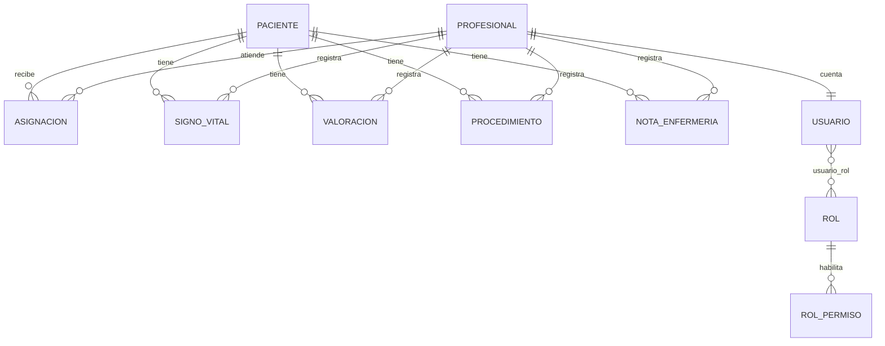

# Modelo de base de datos

El perfil predeterminado usa H2 en archivo: `data/enfermeria.mv.db`. Hibernate genera las tablas a partir de las entidades; el archivo se crea al iniciar la aplicación y conserva los registros entre reinicios.

`auditoria` conserva tipo de registro, ID, acción, usuario, fecha/hora, motivo y datos anteriores a una corrección o anulación. Cada registro clínico incluye `version` para concurrencia, `anulado` y `motivo_anulacion`. La anulación conserva el registro y sus relaciones.

Las claves foráneas `paciente_id` y `profesional_id` son obligatorias. El documento y código de paciente son únicos, al igual que el usuario del profesional. Las contraseñas de profesionales se guardan como hash BCrypt.

Evaluación 2: `usuario.profesional_id` es una FK única que implementa OneToOne. `usuario_rol` contiene las FKs de Usuario y Rol y representa ManyToMany. `rol_permiso` es una colección de permisos enumerados asociada al rol. Usuarios y roles incluyen estado activo y versión. Los campos antiguos de Profesional se mantienen por compatibilidad; la autenticación y autorización utilizan Usuario y sus roles activos. El arranque migra cuentas antiguas sin alterar IDs de pacientes o profesionales ni sus registros clínicos.

Para MySQL, crea la base con `mysql.sql` y usa las variables y el comando documentados en el README principal. La creación automática de tablas es apropiada para esta demostración; un despliegue institucional necesitaría migraciones versionadas y sus propias políticas de acceso y respaldo.
